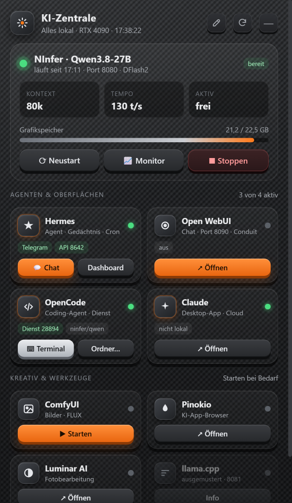
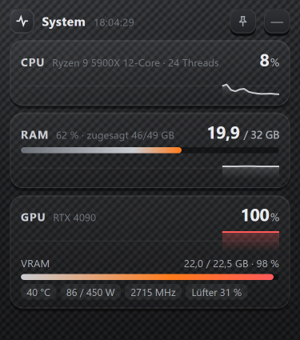

<div align="center">


# KI-Zentrale

**A desktop widget for all your local AI tools – live status, one-click actions and a system monitor.**

[](https://github.com/romkakojo/ki-zentrale/actions/workflows/build.yml)
[](https://github.com/romkakojo/ki-zentrale/releases/latest)
[](LICENSE)

[Deutsch](README.md) · [Download](https://github.com/romkakojo/ki-zentrale/releases/latest) · [Changelog](CHANGELOG.md)

 &nbsp; 

</div>

---

Running local LLMs quickly means juggling many programs: a model server, an agent, a chat UI, a coding agent, image generators … **KI-Zentrale** (German for "AI hub") puts them all into one small anthracite/carbon-styled window – and detects on first start what is installed on your PC.

> The user interface is currently in German.

## Features

- **Auto-detection** of installed tools, their paths, launch scripts, ports and logs. Missing tools are hidden.
- **Model server at a glance** – status, context size, speed (tokens/s), VRAM; start, restart, stop, monitor.
- **A tile per tool** with live status and quick actions (open, start, chat, terminal, project folder).
- **Customizable layout** – ✎ edit mode: drag tiles on a grid, remove and re-add them.
- **System monitor** – CPU, RAM and GPU (load, VRAM, temperature, power, fan) with a 60 s history; 📌 pin it always on top.
- **Unobtrusive** – lives in the notification area, no taskbar entry, borderless rounded windows.
- **Saves VRAM** – the UI renders without GPU acceleration so the model keeps the VRAM.
- **Any display** – DPI-aware placement (100–300 % scaling, multi-monitor) with a watchdog.
- **100 % local** – no account, no telemetry, no open network port ([privacy](PRIVACY.md)).

## Supported tools

[NInfer](https://github.com/JGamboa/ninfer-4090-windows) · [llama.cpp](https://github.com/ggml-org/llama.cpp) · [Hermes Agent](https://github.com/NousResearch/hermes-agent) · [Open WebUI](https://github.com/open-webui/open-webui) (desktop app) · [OpenCode](https://github.com/sst/opencode) · Claude Desktop · ComfyUI · Pinokio · Luminar AI

## Install

Download **[KI-Zentrale-Setup.exe](https://github.com/romkakojo/ki-zentrale/releases/latest)** and run it. Per-user install, no admin rights; the app ships its own .NET runtime and only needs the WebView2 runtime (included in Windows 11). Silent install: `KI-Zentrale-Setup.exe /S`. The installer is not code-signed, so SmartScreen may warn on first run.

## Build

```powershell
git clone https://github.com/romkakojo/ki-zentrale.git
cd ki-zentrale
./build.ps1          # output: artifacts\KI-Zentrale-Setup.exe
```

See [COMPILING.md](COMPILING.md) and [docs/ARCHITECTURE.md](docs/ARCHITECTURE.md).

## License

[MIT](LICENSE). KI-Zentrale is an independent project and not affiliated with the vendors of the supported tools.
