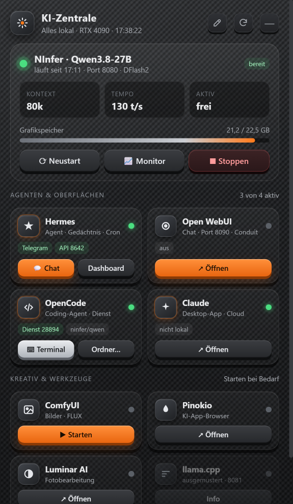
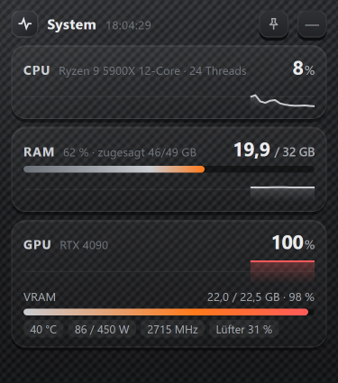
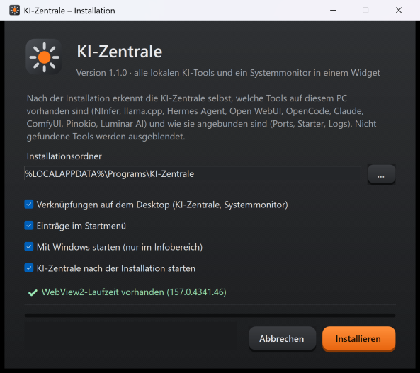

<div align="center">


# KI-Zentrale

**Ein Desktop-Widget für alle lokalen KI-Tools – mit Live-Status, Ein-Klick-Aktionen und Systemmonitor.**

[](https://github.com/romkakojo/ki-zentrale/actions/workflows/build.yml)
[](https://github.com/romkakojo/ki-zentrale/releases/latest)
[](https://github.com/romkakojo/ki-zentrale/releases)
[](LICENSE)


[English](README.en.md) · [Download](https://github.com/romkakojo/ki-zentrale/releases/latest) · [Alle Funktionen](docs/FUNKTIONEN.md) · [Änderungen](CHANGELOG.md)

 &nbsp; 

</div>

---

Wer lokale Sprachmodelle betreibt, jongliert schnell mit vielen Programmen: einem Modellserver, einem Agenten, einer Chat-Oberfläche, einem Coding-Agenten, Bildgeneratoren … Die **KI-Zentrale** fasst alles in einem kleinen Fenster im Anthrazit-/Carbon-Design zusammen – und erkennt beim ersten Start selbst, was auf dem PC installiert ist.

## Funktionen

- **Selbsterkennung** – findet installierte Tools, ihre Pfade, Starter-Skripte, Ports und Logs automatisch. Nicht vorhandene Tools werden ausgeblendet.
- **Modellserver auf einen Blick** – Status, Kontextgröße, Tempo (Token/s), Grafikspeicher; Starten, Neustart, Stoppen, Monitor.
- **Kacheln für jedes Tool** – Live-Status und 1–2 Aktionen (öffnen, starten, Chat, Terminal, Projektordner).
- **Frei anordnen** – ✎ Bearbeiten-Modus: Kacheln per Ziehen im Raster verschieben, entfernen und wieder hinzufügen.
- **Systemmonitor** – CPU, RAM und GPU (Auslastung, VRAM, Temperatur, Leistung, Lüfter) mit 60-Sekunden-Verlauf; per 📌 dauerhaft im Vordergrund.
- **Unaufdringlich** – lebt im Infobereich (Tray), kein Taskleisten-Eintrag, randlose Fenster mit abgerundeten Ecken.
- **Spart Grafikspeicher** – die Oberfläche läuft ohne GPU-Beschleunigung, damit der VRAM dem Modell bleibt.
- **Jede Anzeige** – DPI-sichere Platzierung (100–300 % Skalierung, mehrere Monitore); ein Wächter holt verschwundene Fenster zurück.
- **100 % lokal** – kein Konto, keine Telemetrie, kein offener Netzwerk-Port ([Datenschutz](PRIVACY.md)).

➡️ **[Vollständige Beschreibung aller Funktionen](docs/FUNKTIONEN.md)**

## Unterstützte Tools

| Tool | Erkennung | Aktionen |
|---|---|---|
| [NInfer](https://github.com/JGamboa/ninfer-4090-windows) (Modellserver) | Prozess / Laufwerkssuche, Starter-Skript, Port, Modell, Log | Starten, Neustart, Stoppen, Monitor, Tempo & Kontext |
| [llama.cpp](https://github.com/ggml-org/llama.cpp) | Prozess / Laufwerkssuche | Status (als „ausgemustert“ markiert, wenn NInfer vorhanden ist) |
| [Hermes Agent](https://github.com/NousResearch/hermes-agent) | Installationsordner, API-Server und Telegram aus `.env` | Chat (über Open WebUI), Dashboard |
| [Open WebUI](https://github.com/open-webui/open-webui) (Desktop-App) | Programmliste, eigener Port | Öffnen |
| [OpenCode](https://github.com/sst/opencode) | Suchpfad, Hintergrunddienst | Terminal, Projektordner wählen |
| Claude Desktop, ComfyUI, Pinokio, Luminar AI | Startmenü | Öffnen / Starten |

Fehlt dein Lieblings-Tool? [Wunsch eintragen](https://github.com/romkakojo/ki-zentrale/issues/new?template=feature_request.yml).

## Installation

1. **[KI-Zentrale-Setup.exe](https://github.com/romkakojo/ki-zentrale/releases/latest)** herunterladen und starten.
2. Optionen wählen (Desktop-Verknüpfungen, Startmenü, mit Windows starten) → **Installieren**.
3. Beim ersten Start zeigt die KI-Zentrale, welche Tools sie gefunden hat.



- Installation **pro Benutzer, ohne Admin-Rechte** nach `%LOCALAPPDATA%\Programs\KI-Zentrale`.
- Keine Vorinstallation nötig: die App bringt ihre .NET-Laufzeit mit; benötigt wird nur die **WebView2-Laufzeit** (bei Windows 11 vorhanden, das Setup prüft das).
- Still installieren: `KI-Zentrale-Setup.exe /S`
- Deinstallieren: *Einstellungen → Apps → Installierte Apps → KI-Zentrale* oder Startmenü → „KI-Zentrale deinstallieren“.

> **Hinweis:** Das Setup ist nicht signiert. Windows SmartScreen kann beim ersten Start warnen („Weitere Informationen → Trotzdem ausführen“).

## Bedienung

| | |
|---|---|
| Tray-Symbol, Linksklick | Widget ein-/ausblenden |
| Tray-Symbol, Rechtsklick | Anzeigen, Ausblenden, Systemmonitor, Tools neu erkennen, erkannte Tools, mit Windows starten, Beenden |
| Kopfzeile ziehen | Fenster verschieben |
| ✎ | Bearbeiten-Modus (Kacheln ziehen, × entfernen, + hinzufügen) |
| Pulskurve | Systemmonitor ein-/ausblenden |
| — | in den Infobereich ausblenden |
| `KI-Zentrale.exe --monitor` | nur den Systemmonitor öffnen |

Einstellungen liegen in `%LOCALAPPDATA%\KI-Zentrale\` (`config.json` = erkannte Tools, `layout.json`, `monitor.json`).

## Selbst bauen

```powershell
git clone https://github.com/romkakojo/ki-zentrale.git
cd ki-zentrale
./build.ps1          # Ergebnis: artifacts\KI-Zentrale-Setup.exe
```

Voraussetzungen und Details: [COMPILING.md](COMPILING.md) · Aufbau: [docs/ARCHITECTURE.md](docs/ARCHITECTURE.md)

## Mitmachen

Fehler melden, Ideen einbringen oder Code beitragen – siehe [CONTRIBUTING.md](CONTRIBUTING.md).

## Lizenz

[MIT](LICENSE). Die KI-Zentrale ist ein unabhängiges Projekt und steht in keiner Verbindung zu den Herstellern der unterstützten Tools; alle Marken gehören ihren Inhabern.
